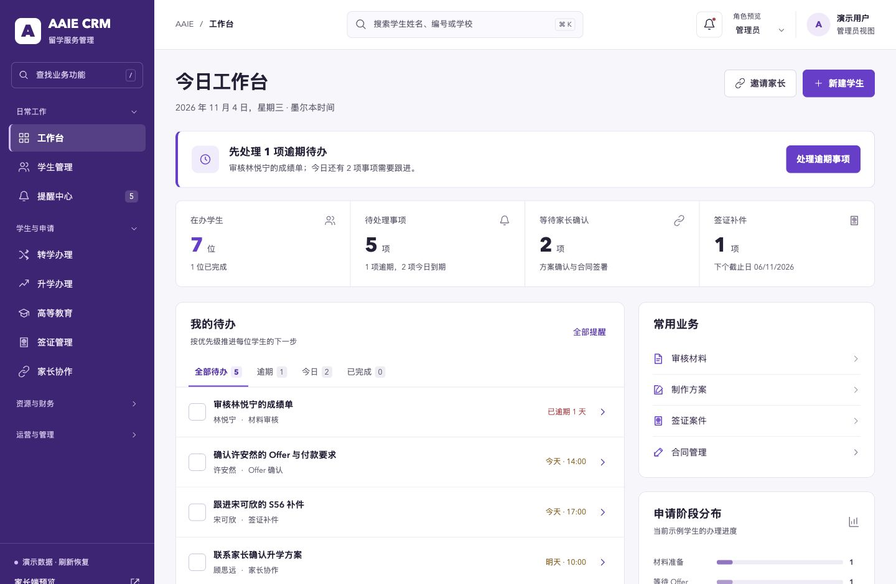

# AAIE CRM Prototype · 紫色第二版

以公司的紫色为品牌基础，围绕顾问的待办和学生办理流程重新设计。保留原型全部业务模块及关键交互。

## 打开

直接用浏览器打开 `index.html`，保留同目录 CSS/JavaScript 文件；或单独打开 `crm-redesign-demo.html`。

本地开发预览：

```sh
python3 qa/preview-server.py
```

访问 `http://127.0.0.1:9137/index.html`。预览服务只提供原型文件，不接入 CRM 服务或真实业务数据。

## 这版调整

- 紫色品牌导航、白色业务画布、独立业务状态色。
- 逾期待办入口、功能搜索、可折叠模块导航。
- 学生详情按源系统重排为 12 个业务分区（学生资料 + 11 个业务 Tab），手机端使用下拉选择器进入全部分区。
- 增大正文、表格、按钮与表单；键盘焦点可见，对话框操作区在手机视口中保留。

## 业务完整性

26个源码模块、5类补充场景、89个独立页面状态全部保留。`data.js` 与第一版逐字节一致。

学生档案、材料、学校方案、Offer、COE/OSHC、签证、转学升学、高等教育、合同、收入佣金、家长协作、学校课程、内容运营、Agent Reach、文件、数据更新、报表和系统管理均有入口。

[业务覆盖](BUSINESS-COVERAGE.md) · [学生模块源码对齐表](STUDENT-PARITY.md) · [设计说明](DESIGN.md) · [验收记录](VALIDATION.md)

## 验证

学生管理模块按源系统重新对齐：列表列、工具栏、筛选、汇总卡片与 12 个详情分区逐项一致；`fields.py` 的 11 个资料分区、105 个字段逐项一致。详见 [学生模块源码对齐表](STUDENT-PARITY.md)。

本次通过237项浏览器检查，并补充通过91项单文件版检查：89个页面状态、89个手机页面宽度检查、关键业务流程、角色预览、导航、表单、360/390/768/1440宽度与品牌样式。

[本次逐项结果](qa/purple-results.json) · [源码模块对照](qa/module-coverage.json)



保留的 `qa/verify.cjs` 与 `qa/review-checks.cjs` 是可复用的业务回归脚本，需要 Node.js、Playwright 及 Chrome/Chromium。通过 `PROTOTYPE_BASE_URL` 可指定测试地址，`PLAYWRIGHT_CHROMIUM_EXECUTABLE_PATH` 可指定已有浏览器。此次实际验收通过 Codex 内置浏览器完成，结果保存在 `purple-results.json`。

## 范围

全部人物、学校、金额和状态均为虚构示例。操作仅更新当前页面内存，刷新恢复。角色切换只演示界面权限，正式服务端权限、微信认证、签署证据、PDF/Office生成、OCR/AI、财务算法、NAS/Drive、采集和备份恢复仍需接入正式CRM服务。
