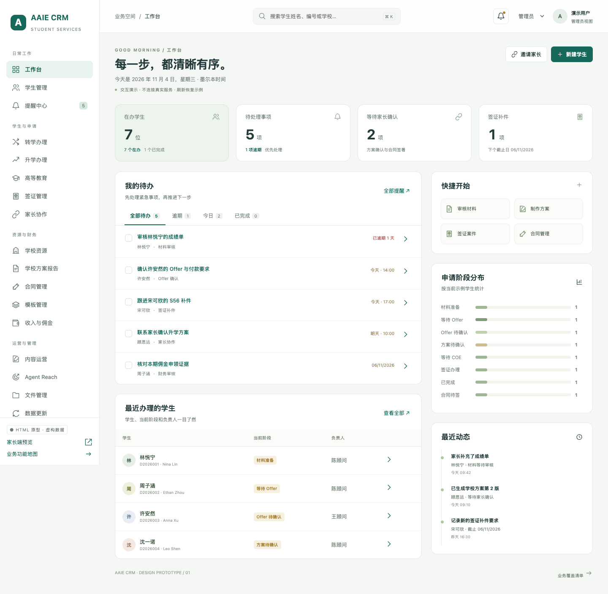

# AAIE CRM Prototype

AAIE CRM 页面重设计原型：以任务工作台与学生办理工作区组织业务，提供桌面和手机布局。

## 打开原型

- 下载仓库后，用浏览器打开 `index.html`，保留同目录的 CSS/JavaScript 文件。
- 或直接打开单文件版本 `crm-redesign-demo.html`，无需其他文件。
- 无需启动 CRM、安装运行依赖或登录。GitHub 文件页显示 HTML 源码，下载后可在浏览器体验交互。

全部学生、家长、学校、金额和状态均为虚构示例。操作只更新当前页面内存，刷新恢复；不连接真实 CRM、数据库、NAS、微信或 Drive。

## 业务覆盖

覆盖源码定义的 **26 个业务模块**，另包含转学、升学、住宿接机、学生历史跟进和家长端 5 类补充场景。浏览器检查覆盖 89 个页面状态。

- 工作台、学生资料、家庭背景、申请材料与审核、申请周期、学校方案与递交、Offer、COE/OSHC。
- 转学升学办理及完成条件、高等教育、签证案件/信息采集/证据/S56/结果。
- 合同、模板版本、收费收款、收据、佣金申领、一级代理、对账异常。
- 家长协作、内容运营、Agent Reach、学校与课程、文件、数据更新、报表、权限与系统管理。

详见 [业务覆盖说明](BUSINESS-COVERAGE.md) 与原型中的“业务功能地图”。覆盖指页面、业务信息和交互演示，正式后台能力未接入。

## 建议体验

1. 工作台查看待办，进入学生档案，审核材料或记录跟进。
2. 学校方案添加/移除与排序，分别体验家长确认和正式递交。
3. 进入转学/升学记录，逐项确认条件，观察完成按钮解锁。
4. 家长端预览填写资料、选校留言、演示签署；不同学生和表单类型分别保存草稿。
5. 体验模板编辑/预览/发布、佣金申领条件、只读/顾问/财务等角色视图。

## 验收

144 项浏览器检查通过，另对目录版和单文件版完成 62 个交付入口检查。包含桌面与手机布局、跨学生数据隔离、材料同步、模板版本、关键流程和零远程业务请求检查。

[验收记录](VALIDATION.md) · [详细检查结果](qa/results.json) · [审查回归](qa/review-results.json)



## 开发与测试

`index.html`、`styles.css`、`data.js`、`app.js` 是可编辑源文件；`crm-redesign-demo.html` 是对应的单文件快照。

浏览器测试需要 Node.js、Playwright 和 Chrome/Chromium。`PLAYWRIGHT_CHROMIUM_EXECUTABLE_PATH` 可指定已有浏览器；否则使用 Playwright 配置的默认浏览器。

```sh
node qa/verify.cjs
node qa/review-checks.cjs
```

验收脚本会更新 `qa/` 中的演示结果及截图；不接触真实业务数据。

正式微信认证、签署证据、PDF/Office 生成、OCR/AI、财务算法、NAS/Drive、采集和备份恢复仍需接入现有 CRM 服务。
